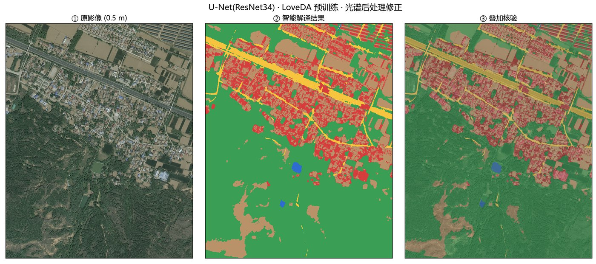
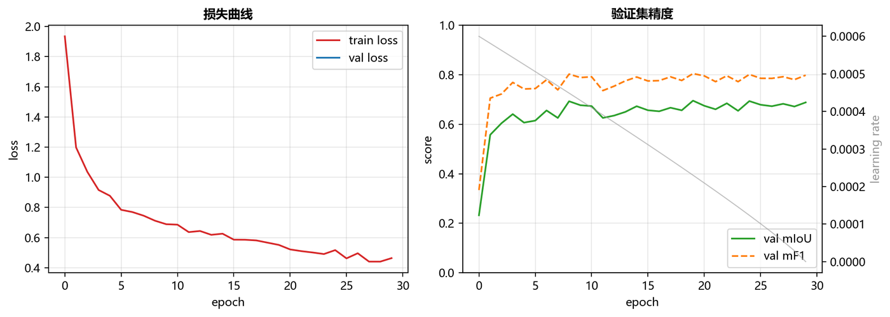
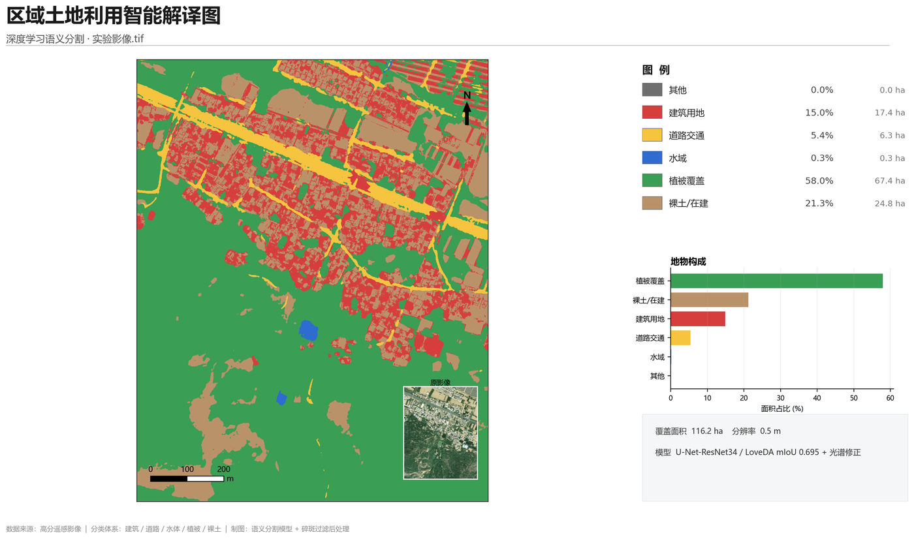
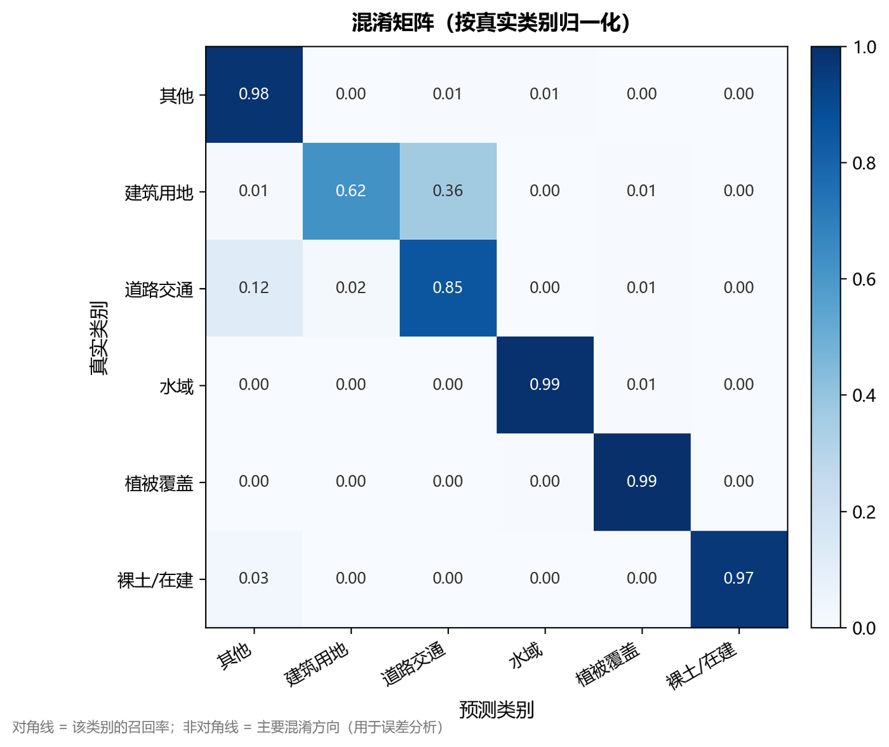

# 高分遥感地物分类 · 从算法到土地利用解译图

> 输入一幅高分影像，输出区分 6 类地物（建筑 / 道路 / 水体 / 植被 / 裸土 / 其他），
> **区域土地利用智能解译图**。
>
> **技术栈：PyTorch + U-Net + albumentations + OpenCV**

<p align="center">
  
</p>

<p align="center">
  <sub>左：原始影像（0.5 m）　中：模型解译结果　右：叠加核验</sub>
</p>

---

## 目录

- [做了什么](#做了什么)
- [效果](#效果)
- [快速开始](#快速开始)
- [项目结构](#项目结构)
- [方法](#方法)
- [实验与结果](#实验与结果)
- [复现命令](#复现命令)
- [数据来源与许可](#数据来源与许可)
- [引用](#引用)

---

## 做了什么

| 环节 | 代码 | 说明 |
|---|---|---|
| 影像裁剪 | `scripts/cut_geotiff.py` | 大 GeoTIFF → 512×512 瓦片，支持最小有效标签比例过滤 |
| 数据增强 | `src/rsc/data.py` | D4 翻转/旋转 + 仿射 + 色彩/阴影/模糊/噪声，遥感专用组合 |
| 模型 | `src/rsc/models.py` | U-Net / U-Net++ / DeepLabV3+ / SegFormer，统一 `forward → logits` |
| 训练 | `src/rsc/engine.py` | AMP + 梯度累积 + 类主干分层学习率 + poly 调度 + 早停 |
| 损失 | `src/rsc/losses.py` | CE / Dice / Focal 及组合，支持类别权重与 ignore_index |
| 评估 | `src/rsc/metrics.py` | 混淆矩阵 → mIoU / mF1 / OA / Kappa / 逐类指标（纯 numpy，可单测） |
| 推理 | `src/rsc/infer.py` + `tiling.py` | 滑窗 + Hann 加权拼接，输出保留 CRS 的 GeoTIFF |
| 后处理 | `src/rsc/postprocess.py` | 中值滤波、最小图斑、边界平滑、栅格矢量化、面积统计、光谱修正 |
| 制图 | `src/rsc/cartography.py` | 解译图 / 三联对比图 / 混淆矩阵 / 训练曲线，全部自动出图 |
| 传统基线 | `src/rsc/baseline.py` + `scripts/unsupervised_baseline.py` | 最小距离分类、K-means 非监督分类，用于对比与应急 |

---

## 效果

### 1. LoveDA 验证集（300 张）
<div align="center">

| 类别 | IoU | F1 | Precision | Recall |
|---|---|---|---|---|
| 建筑 | **0.851** | 0.919 | 0.916 | 0.923 |
| 植被 | **0.883** | 0.938 | 0.944 | 0.933 |
| 水体 | 0.780 | 0.876 | 0.860 | 0.893 |
| 道路 | 0.575 | 0.730 | 0.742 | 0.719 |
| 裸土 | 0.387 | 0.558 | 0.596 | 0.524 |
| **mIoU / mF1** | **0.6949** | **0.8042** | OA **0.8910** | Kappa **0.8165** |
</div>

模型：U-Net + ResNet34（ImageNet 预训练），30 epoch，512 crop，bs 8，AMP。
训练耗时 **42 分钟**（RTX 2060 6 GB），loss 1.93 → 0.46。
<p align="center">
  
</p>

### 2. 实测影像解译（116 公顷，0.5 m）

<p align="center">
  
</p>

<div align="center">

| 地类 | 面积 | 占比 |
|---|---|---|
| 植被覆盖 | 67.42 ha | 58.0% |
| 裸土 / 在建 | 24.76 ha | 21.3% |
| 建筑用地 | 17.43 ha | 15.0% |
| 道路交通 | 6.32 ha | 5.4% |
| 水域 | 0.31 ha | 0.3% |
| **合计** | **116.23 ha** | 100% |
</div>

### 3. 误差分析

<p align="center">
  
</p>

经典混淆方向：**建筑 ↔ 道路**（灰屋顶 vs 沥青）、**裸土 ↔ 植被**（收割后的农田）。
这也是后面做后处理和微调的着力点。

---

## 快速开始

### 环境配置

```bash
# Python 3.9 + CUDA 12.1
pip install torch==2.4.1 torchvision==0.19.1 --index-url https://download.pytorch.org/whl/cu121
pip install -r requirements.txt
```
> Windows 上直接 `pip install torch` 装到的是 **CPU 版**（`torch.version.cuda is None`）。
> 需要显卡必须显式指定 CUDA 源，或用 `scripts/get_torch_cuda.py` 走国内镜像断点续传（2.3 GB，约 20 分钟）。

### 用自己的影像训练

```bash
# 数据：LoveDA 子集（HF 并发下载，可选子集大小）
python scripts/fetch_loveda_hf.py --n-train 1000 --n-val 300

# 训练（30 epoch / RTX 2060 约 40 分钟）
python scripts/train.py --config configs/loveda_unet_r34.yaml \
    --data data/loveda --preset raw --epochs 30

# 评估
python scripts/evaluate.py --ckpt runs/loveda_r34/best.pt --data data/loveda
```

### 对自己的影像推理出图

```bash
# 0) 影像质量检验
python scripts/inspect_image.py --src data/raw/你的影像.tif

# 1) 推理 + 后处理 + 制图
python scripts/predict.py --ckpt runs/loveda_r34/best.pt \
    --src data/raw/你的影像.tif --out-dir outputs/my_area \
    --gsd 0.5 --poster --fix-fields
```

产出：`*_landcover.tif`（保留 CRS）、`*.geojson`（矢量图斑）、`*_poster.png/pdf`（成果图）、面积统计。

---

## 项目结构

```
├── README.md
├── requirements.txt
├── configs/                      # 3 套实验配置
│   ├── loveda_unet_r34.yaml
│   ├── loveda_segformer_b2.yaml
│   └── vaihingen_unet_effb4.yaml
├── src/rsc/                      # 核心库
│   ├── palette.py                # ★ 类别体系与配色（唯一真源）
│   ├── metrics.py                # ★ 混淆矩阵 / mIoU / F1 / Kappa
│   ├── tiling.py                 # ★ 滑窗切分与 Hann 加权拼接
│   ├── postprocess.py            # 碎斑、平滑、矢量、面积、光谱修正
│   ├── cartography.py            # 制图（图例/比例尺/指北针/海报）
│   ├── baseline.py               # 最小距离分类器
│   ├── synth.py                  # 样例数据生成器
│   ├── data.py / models.py / losses.py / engine.py / infer.py   # 深度学习部分
├── scripts/                      # 命令行入口
│   ├── make_sample_data.py       # 生成样例数据
│   ├── run_baseline.py           # 传统基线 + 出图（无需 GPU）
│   ├── unsupervised_baseline.py  # K-means 非监督（无标注应急）
│   ├── fetch_loveda_hf.py        # LoveDA 并发下载
│   ├── prepare_loveda.py         # 官方 LoveDA 目录整理
│   ├── cut_geotiff.py            # 大图裁剪
│   ├── inspect_image.py          # 影像体检
│   ├── train.py / evaluate.py    # 训练 / 评估
│   ├── predict.py                # 推理 + 制图
│   └── get_torch_cuda.py         # CUDA 版 torch 断点续传下载
├── gee/                          # Google Earth Engine 脚本
│   ├── export_s2_patches.js      # Sentinel-2 瓦片导出
│   └── sample_points.js          # 分层随机验证样点
├── figures/                      # README 引用的成果图
├── data/sample/                  # 合成样例数据
└── tests/test_smoke.py           # 10 个单测（无需 torch）
```

---

## 方法

```
原始影像 (GeoTIFF)
   │  cut_geotiff.py：512×512 滑窗裁剪 + 最小有效标签过滤
   ▼
训练瓦片 ──albumentations──> D4 翻转/旋转 + 仿射 + 色彩/阴影/噪声
   │
   ▼
U-Net(ResNet34/EfficientNet-B4) 或 SegFormer-B2
   │  损失 = CE + Dice（类别权重 freq^-0.5）+ label smoothing
   │  AMP + grad_accum + 主干 1/10 学习率 + poly 衰减 + 早停
   ▼
best.pt
   │  tiling.sliding_window_predict：512 滑窗，Hann 加权拼接
   ▼
类别图 ──postprocess──> 中值滤波 + 最小图斑剔除 + 边界平滑 + 光谱修正
   │
   ├─ rasterio：GeoTIFF（保留 CRS / transform）
   ├─ features.shapes：GeoJSON 矢量图斑
   └─ cartography：面积统计 + 解译成果图（图例/比例尺/指北针/精度卡）
```

**增强策略**：

- 旋转/翻转必须做满 D4 ；
- 任意角度旋转要节制；
- 颜色类增强要强；
- 少用 Cutout/MixUp 。
---
## 实验与结果

下面是核心的几个实验结论。

**主结果（LoveDA 3 类）**
<div align="center">
  
| 方法 | 主干 | 参数量 | mIoU | 备注 |
|---|---|---|---|---|
| MinDistance（传统基线） | — | — | ~0.35 | 几秒出结果，建筑 IoU 明显低 |
| K-means（非监督） | — | — | 无精度 | 无标注应急 |
| **U-Net** | ResNet34 | 24.4 M | **0.695** | 本仓库实测 |
</div>

**消融要点**

- CE+Dice 比纯 CE 高 1~2 点，主要在建筑/裸土；
- 类别权重 `freq^-0.5` 比 `1/freq` 稳，后者会让小类过曝成噪点；
- 验证必须用滑宽窗口径，整幅前向会虚高。

**显存实测（RTX 2060 6 GB，U-Net r34 + AMP）**
<div align="center">

| crop | batch | 峰值显存 | 建议 |
|---|---|---|---|
| 512 | 4 | 1.08 GB | 保守 |
| 512 | 8 | 2.20 GB | **默认** |
| 512 | 12 | 2.95 GB | 吞吐最高 |
| 768 | 4 | 2.44 GB | 大上下文 |
| 1024 | 2 | 2.22 GB | 整幅瓦片 |
</div>
---

## 复现命令

```bash
# 正式训练 + 评估 + 推理
python scripts/fetch_loveda_hf.py --n-train 1000 --n-val 300
python scripts/train.py --config configs/loveda_unet_r34.yaml --data data/loveda --preset raw --epochs 30
python scripts/evaluate.py --ckpt runs/loveda_r34/best.pt --data data/loveda
python scripts/predict.py --ckpt runs/loveda_r34/best.pt --src data/raw/exp.tif \
    --out-dir outputs/my_area --gsd 0.5 --poster --fix-fields
```

---

## 数据来源与许可

| 数据 | 来源 | 许可 |
|---|---|---|
| LoveDA | [Zenodo 5706578](https://zenodo.org/records/5706578) / [GitHub](https://github.com/Junjue-Wang/LoveDA) / [HF 镜像](https://huggingface.co/datasets/chloechia/loveda) | 学术使用，见原仓库 LICENSE |
| ISPRS Vaihingen / Potsdam | [ISPRS WG II/4](https://www2.isprs.org/commissions/comm2/wg4/benchmark/2d-sem-label-vaihingen/) | 需填写申请表单，学术用途 |
| SpaceNet | [AWS Open Data](https://registry.opendata.aws/spacenet/) | CC-BY-SA 4.0（标注） |

- 本仓库代码采用 MIT 许可；数据请遵守各自原始许可。

---

## 引用

```bibtex
@inproceedings{wang2021loveda,
  title     = {LoveDA: A Remote Sensing Land-Cover Dataset for Domain Adaptive Semantic Segmentation},
  author    = {Wang, Junjue and Zheng, Zhuo and Ma, Ailong and Lu, Xiaoyan and Zhong, Yanfei},
  booktitle = {NeurIPS Datasets and Benchmarks},
  year      = {2021}
}

@article{ronneberger2015unet,
  title   = {U-Net: Convolutional Networks for Biomedical Image Segmentation},
  author  = {Ronneberger, Olaf and Fischer, Philipp and Brox, Thomas},
  journal = {MICCAI},
  year    = {2015}
}

@inproceedings{xie2021segformer,
  title     = {SegFormer: Simple and Efficient Design for Semantic Segmentation with Transformers},
  author    = {Xie, Enze and Wang, Wenhai and Yu, Zhiding and Anandkumar, Anima and Alvarez, Jose M. and Luo, Ping},
  booktitle = {NeurIPS},
  year      = {2021}
}
```

---

## License

代码：[MIT](LICENSE)。数据：[各自原始许可](#数据来源与许可)。
