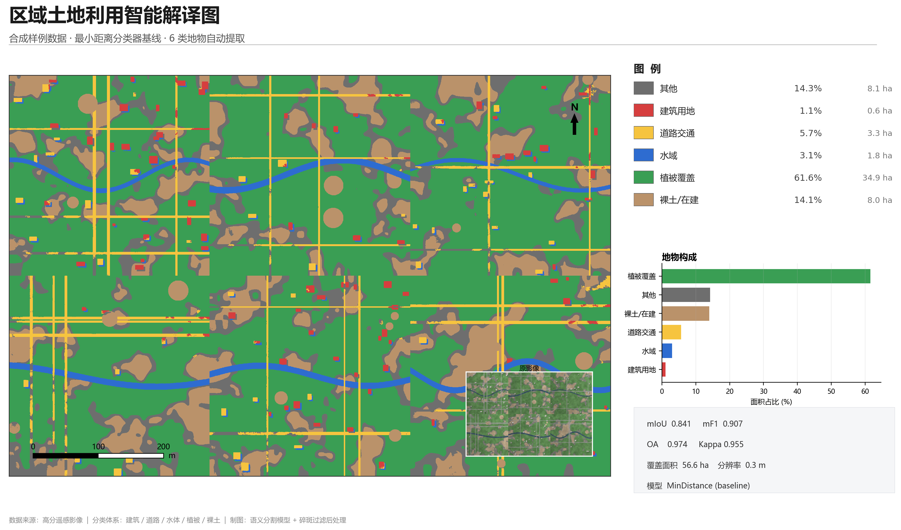

### 高分遥感地物分类（建筑/道路/水体/植被/裸土）— 可运行的工程骨架

> 目标：输入一幅高分正射影像，输出**像素级 6 类地物分类图**，并加工成一张能进报告的
> **"区域土地利用智能解译图"**。技术栈：Python + PyTorch + U-Net/SegFormer + albumentations + OpenCV。
>
> 这个仓库不是"代码片段合集"，而是**一条能跑通的完整链路**：裁剪 → 增强 → 训练 → 评估 → 后处理 → 制图 → 落盘 GeoTIFF。
> 其中不依赖 GPU 的部分（数据、指标、切片、后处理、制图）**已经在当前机器上跑通并给出真实数字**（见 §5）。

---

### 1. 一页看懂

| 环节 | 产出 | 代码 |
|---|---|---|
| 影像裁剪 | 512×512 训练瓦片（影像+标签） | `scripts/cut_geotiff.py` |
| 数据增强 | D4 翻转/旋转 + 色彩/模糊/噪声/阴影 | `src/rsc/data.py` |
| 模型 | U-Net(r34/efficientnet-b4) / SegFormer-B2 | `src/rsc/models.py` |
| 训练 | AMP + 梯度累积 + 类别权重 CE+Dice + 早停 | `src/rsc/engine.py` |
| 评估 | mIoU / mF1 / OA / Kappa / 逐类 IoU·F1 + 样点法 | `src/rsc/metrics.py` |
| 后处理 | 中值滤波 + 边界平滑 + 最小图斑剔除 | `src/rsc/postprocess.py` |
| 推理 | 滑窗拼接（Hann 加权）+ 保留 CRS 的 GeoTIFF | `src/rsc/infer.py` |
| 制图 | 解译图 / 三联对比图 / 混淆矩阵 / 训练曲线 | `src/rsc/cartography.py` |

**成果图预览**（用合成样例数据 + 最小距离基线生成，仅验证制图链路）：



---

### 2. 目录结构

```
rs-landcover/
├── README.md                     ← 你正在看的实施总纲
├── requirements.txt
├── configs/                      ← 3 套实验配置（U-Net / SegFormer / Vaihingen）
├── data/sample/                  ← 已生成的样例数据（11 张 1024² 瓦片 + 2048×3072 场景 + 720 样点）
├── src/rsc/
│   ├── palette.py                ★ 类别体系与配色（全项目唯一真源）
│   ├── metrics.py                ★ 混淆矩阵 / mIoU / F1（纯 numpy，可单测）
│   ├── tiling.py                 ★ 滑窗切分与 Hann 加权拼接
│   ├── postprocess.py            碎斑过滤 / 平滑 / 矢量化 / 面积统计
│   ├── cartography.py            制图（图例/比例尺/指北针/面积统计/海报）
│   ├── baseline.py               传统方法基线（最小距离分类器）
│   ├── synth.py                  样例数据生成器
│   ├── data.py                   Dataset + albumentations 增强（需 torch）
│   ├── models.py                 U-Net / SegFormer（需 torch）
│   ├── losses.py                 CE/Dice/Focal（需 torch）
│   ├── engine.py                 训练/验证循环（需 torch）
│   └── infer.py                  推理 + GeoTIFF 落盘
├── scripts/                      ← 全部命令行入口
├── gee/                          ← GEE：S2 瓦片导出 + 分层随机样点
├── tests/test_smoke.py           ← 10 个单测（无需 torch）
└── docs/
    ├── 01_数据与标注.md
    ├── 02_实验设计.md
    └── 03_制图与GEE闭环.md
```

---

### 3. 三步上手

> **完全没用过命令行？** 直接双击根目录的 **`一键运行.bat`**，它会自动检查环境、装依赖、跑测试、出图，
> 并把成果图弹出来。详细的零基础讲解见 [docs/00_新手一步步.md](00_新手一步步.md)。

### 第 1 步：不用 GPU，先验证环境（1 分钟）

```bat
python tests\test_smoke.py                      :: 应输出 10/10 通过
python scripts\run_baseline.py                  :: 传统基线 + 出 3 张图，约 15 秒
```

> 本机注意：`python` 可能指向微软商店的占位程序，用 `C:\ProgramData\anaconda3\python.exe` 代替即可
> （`一键运行.bat` 会自动找对的解释器）。

`run_baseline.py` 会打印一张精度表，并在 `outputs/` 下生成解译图、三联对比图、混淆矩阵。
**只要这步跑通，说明数据、坐标、指标、配色、制图都是对的**——后面换模型只是把"分类器"换掉。

### 第 2 步：装 GPU 环境（约 10 分钟，需 3~5 GB 下载）

```bat
:: 换国内源会快很多；cu121 对应 RTX 2060(图灵) 完全兼容
pip install torch==2.4.1 torchvision==0.19.1 --index-url https://download.pytorch.org/whl/cu121
pip install -r requirements.txt -i https://pypi.tuna.tsinghua.edu.cn/simple
python -c "import torch;print(torch.__version__, torch.cuda.is_available(), torch.cuda.get_device_name(0))"
```

### 第 3 步：真数据训练

```bat
:: ① 下载 LoveDA（Zenodo，约 3.5 GB）→ 解压 → 整理成本项目结构
python scripts\prepare_loveda.py --src D:\data\LoveDA --dst data\loveda

:: ② 冒烟：2 个 epoch，确认 loss 在降、显存不炸
python scripts\train.py --config configs\loveda_unet_r34.yaml --data data\loveda --epochs 2 --out runs\smoke

:: ③ 正式训练（6GB 卡约 3~5 h / 40 epoch）
python scripts\train.py --config configs\loveda_unet_r34.yaml --data data\loveda

:: ④ 评估 + 混淆矩阵
python scripts\evaluate.py --ckpt runs\loveda_unet_r34\best.pt --data data\loveda

:: ⑤ 整幅影像推理 → GeoTIFF + 成果图
python scripts\predict.py --ckpt runs\loveda_unet_r34\best.pt --src data\raw\area15.tif ^
    --out-dir outputs\area15 --gsd 0.09 --poster
```

---

### 4. 实施步骤（S0 → S7，含验收标准）

| 阶段 | 做什么 | 关键动作 | 验收标准 | 工期 |
|---|---|---|---|---|
| **S0 立项** | 定分类体系与验收口径 | 6 类写死（含"其他"）；定 mIoU 目标（LoveDA-6 类 ≥0.50 及格 / ≥0.60 良好；Vaihingen-6 类 ≥0.68 / ≥0.75） | 一页纸写清：类别定义、研究区、指标 | 0.5 天 |
| **S1 数据** | 下载 + 裁剪 + 检查 | LoveDA 打底；Vaihingen 做小样本对比；`cut_geotiff.py` 切 512/步长 256 | 瓦片数 ≥1000、类别分布表、无标签错位 | 2 天 |
| **S2 基线** | 传统方法先跑通 | `run_baseline.py`（最小距离）+ 可选 GEE 随机森林 | 有 mIoU 数字、有解译图、指标可复现 | 1 天 |
| **S3 训练** | U-Net 主基线 | resnet34 + CE/Dice + AMP；先 512/bs4 | val mIoU 稳定高于传统基线 10 个点以上 | 2 天 |
| **S4 对比** | SegFormer / DeepLabV3+ | 同数据同划分，只换模型 | 3 组结果的 mIoU/F1/参数量/耗时表 | 2 天 |
| **S5 调优** | 消融与后处理 | 损失/增强/输入尺寸/后处理；3 个 seed | 消融表 + 最优配置说明 | 2 天 |
| **S6 制图** | 成果图与统计 | 滑窗推理 → 后处理 → 面积统计 → 解译图 | 1 张 A1 级成果图 + 面积表 | 1 天 |
| **S7 包装** | GEE 闭环 + 答辩材料 | GEE 底图/在线推理；论文图表 | 演示视频 3 min + 技术报告 | 1 天 |

> 合计约 12 个工作日。**关键路径是 S1 和 S3**，S2 提前做能避免"训了三天发现标签映射错了"。

技术路线（数据流）：

```
原始影像(GeoTIFF) ──cut_geotiff──> 512瓦片 ──albumentations──> 训练集
                                                            │
                        U-Net / SegFormer ──CE+Dice(类别权重)──┘
                                    │
                        best.pt ────┴──> 滑窗推理(Hann拼接) ──> 类别图
                                                              │
                            后处理(中值+去碎斑) ──> GeoTIFF + 面积统计 ──> 解译图/报告
```

---

### 5. 当前机器上实测的数字（可复现）

环境：**RTX 2060 6GB / 32 线程 / 128 GB RAM**，无 GPU 深度学习环境时的**基线跑通结果**。

数据：`data/sample`（合成，1024² × 11 瓦片 + 2048×3072 场景）。
方法：最小距离分类器（RGB+ExG+亮度+饱和度），滑窗 512/步长 384。

| 类别 | IoU | F1 | Precision | Recall | GT 像素 |
|---|---|---|---|---|---|
| 背景/其他 | 0.922 | 0.959 | 0.942 | 0.978 | 430,954 |
| 建筑 | 0.652 | 0.790 | 0.927 | 0.687 | 55,779 |
| 道路 | 0.756 | 0.861 | 0.845 | 0.878 | 146,222 |
| 水体 | 0.774 | 0.873 | 0.783 | 0.986 | 53,632 |
| 植被 | 0.994 | 0.997 | 1.000 | 0.994 | 1,990,863 |
| 裸土 | 0.973 | 0.986 | 0.998 | 0.975 | 468,278 |
| **mIoU / mF1** | **0.845** | **0.911** | OA **0.978** | Kappa **0.961** | 3,145,728 |

后处理（中值 3×3 + 最小图斑 80 px）：mIoU 0.825 → 0.834。
整幅 2048×3072 场景推理耗时 **5.2 s**（CPU）。

> ⚠️ 合成数据不能当实验结果。它的作用是：证明**指标、坐标、制图、后处理**都没写错，
> 以及给出一个"传统方法基线"参照。真实数据上最小距离法通常只有 0.35~0.45 mIoU，
> 深度学习应在 **0.55~0.65**（LoveDA 6 类口径，官方 7 类口径下 U-Net ≈0.40~0.45、
> 强 Transformer ≈0.50~0.55；合并 forest/agriculture 后通常高 3~8 个点）；
> Vaihingen-6 类一般能到 0.68~0.76。详细预期见 `02_实验设计.md` §3。

---

### 6. 6 GB 显存调参速查（下表为 RTX 2060 实测）

用 `U-Net + ResNet34`、AMP、AdamW 在 2048×3072 的样例场景上测的前向+反向+优化器峰值显存：

| 配置 | crop | batch | grad_accum | 峰值显存(实测) | 等效 batch | 建议 |
|---|---|---|---|---|---|---|
| U-Net + r34 | 512 | 4 | 2 | **1079 MB** | 8 | 保守 |
| U-Net + r34 | 512 | 8 | 1 | **2203 MB** | 8 | ✅ **默认推荐** |
| U-Net + r34 | 512 | 12 | 1 | **2951 MB** | 12 | 吞吐最高，1.2~1.5 万样本/epoch 时用 |
| U-Net + r34 | 768 | 4 | 2 | **2441 MB** | 8 | 需要更大上下文时 |
| U-Net + r34 | 1024 | 2 | 4 | **2215 MB** | 8 | 整幅 LoveDA 瓦片直接送 |
| SegFormer-B2 | 512 | 2 | 4 | ~3.0 GB（估算，未实测） | 8 | Transformer 显存随边长平方涨 |
| 任意模型 | 384 | 4 | 2 | <1.5 GB | 8 | 兜底 |

> 之前版本里写的 "512/bs4 约 4.5 GB" 是拍脑袋的估计，**实测只有 1.1 GB**，所以 6 GB 卡其实很宽裕：
> 512 分辨率可以开到 batch 12。这也是为什么 `configs/loveda_unet_r34.yaml` 用 `bs8 + accum1`
> 而不是 `bs4 + accum2` —— 等效 batch 一样，但少了梯度累积的来回，训练快 20~30%。

OOM 处理顺序：`crop 384` → `batch 减半` → 换 `resnet34`/`mit_b1` → 关 `AMP`（最后手段）。

---

### 7. 踩过的坑（都写进代码了）

1. **标签值不能想当然**：LoveDA 是 0~6（4=barren、5/6=植被），Vaihingen 是 0~5（0=不透水面）。
   统一走 `palette.remap_labels()`，任何地方直接读原始标签都会出事。
2. **训练/推理的归一化必须一致**：`infer.MEAN/STD` 与 `data.IMAGENET_MEAN/STD` 同源。
3. **整幅 1024 图直接送网络会爆显存**：验证也走滑窗（`engine.validate`），顺便保证"验证=上线"。
4. **滑窗拼接缝**：用 Hann 权重窗（`tiling.hann_window`），uniform 平均会有网格状接缝。
5. **16bit 影像直接 /255**：会得到全黑。必须百分位拉伸（`infer.predict_geotiff` 已处理）。
6. **碎斑**：不做后处理，建筑屋顶上的零星"水体"像素会让成果图没法看。
7. **Windows 下 num_workers>0 偶发卡死**：`data.num_workers: 0` 是最快的排除法。
8. **类别权重别用 1/freq**：平方根 `freq^-0.5` 更稳，否则小类过曝成噪点。

---

### 8. 文档索引

- [docs/00_新手一步步.md](00_新手一步步.md) — **零基础照做即可**：双击运行、看懂三张图、装 PyTorch、第一次训练、7 天节奏、报错对照表
- [docs/01_数据与标注.md](01_数据与标注.md) — 3 个公开数据集的下载/结构/标签映射/坑，自建数据，**样点设计**
- [docs/02_实验设计.md](02_实验设计.md) — 对比实验矩阵、消融、指标口径、结果表模板、时间预算
- [docs/03_制图与GEE闭环.md](03_制图与GEE闭环.md) — 解译图规范、GEE 三种玩法、交付物与亮点话术

### 9. 引用

```
LoveDA: Wang et al., "LoveDA: A Remote Sensing Land-Cover Dataset for Domain Adaptive
        Semantic Segmentation", NeurIPS Datasets & Benchmarks, 2021.
ISPRS:  Rottensteiner et al., "The ISPRS Benchmark on Urban Object Classification and
        3D Building Reconstruction", ISPRS Annals I-3, 2012.
```
